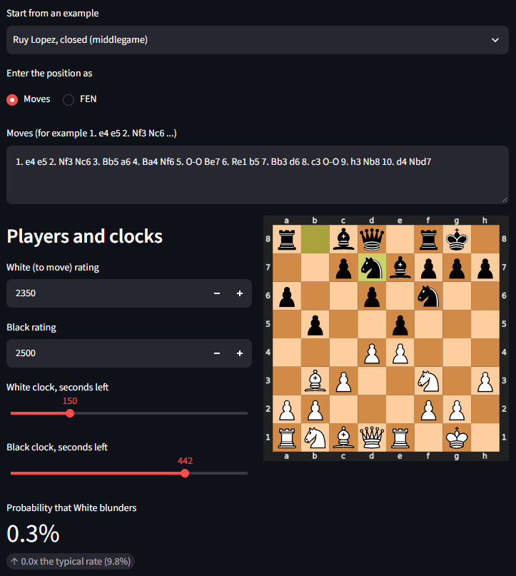

# Chess Blunder Predictor

Predicts the probability that a chess player blunders on their next move, using only the position, both players' ratings and both clocks. No engine evaluation is used as an input.

A **blunder** is a move that loses at least 15 percentage points of win probability (roughly Lichess's own blunder cut-off), measured with Lichess's evaluation-to-win-probability curve. The model is trained on rated 10+0 rapid games from the [Lichess open database](https://database.lichess.org/) and ends up as an ensemble of five residual CNNs.



## Headline results

Evaluated once on a held-out **test split of 1,137,973 positions** (whole games held out, so no game appears in more than one split). The base blunder rate is 9.78%.

| Model | PR-AUC | ROC-AUC | Log loss |
| --- | --- | --- | --- |
| Constant prediction | 0.098 | 0.500 | 0.3202 |
| LightGBM on hand-crafted features | 0.2131 | 0.7291 | 0.2891 |
| CNN, single seed (range over 5 seeds) | 0.2391 - 0.2398 | 0.7574 - 0.7578 | 0.2807 - 0.2808 |
| **CNN, 5-seed ensemble** | **0.2458** | **0.7629** | **0.2789** |

PR-AUC is compared against the base rate, which is what a random ranking scores: the ensemble is **2.5x** better than random and LightGBM **2.2x**.

**Log-loss gain of the CNN ensemble over LightGBM** (positive = CNN better; 95% confidence intervals come from resampling whole games):

| Subset | Positions | Gain | 95% CI |
| --- | --- | --- | --- |
| All positions | 1,137,973 | +0.01019 | [+0.00986, +0.01055] |
| Mover has 120 s or less | 57,776 | +0.00448 | [+0.00307, +0.00574] |
| Mover has 60 s or less | 30,445 | +0.00453 | [+0.00266, +0.00633] |

The CNN also wins in every band of prior win probability (PR-AUC, CNN vs LightGBM):

| Win probability before the move | Positions | Base rate | CNN | LightGBM |
| --- | --- | --- | --- | --- |
| 0.15 - 0.35 | 135,941 | 0.0806 | 0.1811 | 0.1554 |
| 0.35 - 0.65 | 557,550 | 0.0951 | 0.2605 | 0.2235 |
| 0.65 - 0.85 | 162,356 | 0.1817 | 0.3062 | 0.2769 |
| 0.85 - 1.00 | 282,126 | 0.0631 | 0.2079 | 0.1830 |

**Calibration.** The ensemble's probabilities are well calibrated. Across deciles of predicted probability, the mean prediction and the observed blunder rate agree to within about 0.003 (for example, the top decile predicts 28.1% against 28.3% observed). There is a slight systematic under-prediction of about 1% relative.

| Decile | Mean predicted | Observed |
| --- | --- | --- |
| 1 (lowest) | 0.0032 | 0.0032 |
| 2 | 0.0134 | 0.0131 |
| 3 | 0.0280 | 0.0282 |
| 4 | 0.0450 | 0.0461 |
| 5 | 0.0643 | 0.0658 |
| 6 | 0.0860 | 0.0895 |
| 7 | 0.1117 | 0.1130 |
| 8 | 0.1439 | 0.1450 |
| 9 | 0.1884 | 0.1904 |
| 10 (highest) | 0.2813 | 0.2834 |

## What the experiments showed

**1. The board matters most.** With only ratings and ply, LightGBM reaches a PR-AUC of 0.142. Adding 23 hand-crafted board features (material, attacked and undefended pieces, king safety, mobility) raises it to 0.215 (validation set). The strongest single feature is material balance, followed by the mover's rating.

**2. The clock matters, but only in the last minute or two.** Adding clock features to LightGBM barely changes overall performance (+0.0001 log loss, CI [-0.0000, +0.0002]), but in the final minute it helps clearly:

| Subset (validation, 1M positions) | Log-loss gain from clock features | 95% CI |
| --- | --- | --- |
| All positions | +0.00009 | [-0.00001, +0.00018] |
| Mover has 120 s or less | +0.00169 | [+0.00074, +0.00267] |
| Mover has 60 s or less | +0.00363 | [+0.00206, +0.00528] |

The same pattern appeared independently in LightGBM and in two CNN variants on an earlier, smaller dataset (confidence intervals for the final-minute gain excluded zero in each). Only about 3% of positions have under a minute left, which is why the effect is invisible in aggregate metrics.

*A caution about interpretation.* The raw blunder rate does **not** rise with falling clock in the test set (9.6%, 9.0%, 9.0%, 9.6% and 9.8% for clocks of 0-30 s, 30-60 s, 60-120 s, 120-300 s and over 300 s). Positions with little time left are mostly late in the game and often already decided, which hides the effect. Once game phase is held fixed, in balanced positions (25-75% win probability) the blunder rate does rise: from 12.0% (over 300 s) to 19.3% (60 s or less) at plies 30-50, and from 12.7% to 16.8% at plies 50-80. These figures come from the validation split of the smaller early dataset, and some cells are small. The claim supported by the data is that clock features improve prediction in the final minute, not that time pressure causes blunders.

**3. Feeding hand-crafted features into the CNN was the biggest single improvement.** A CNN on raw board planes alone lost to LightGBM at first. After regularisation and more data it overtook it (validation log loss 0.2870 vs 0.2888), and adding the hand-crafted features to its scalar branch took it to 0.2838. Its weakness before that was in positions where one side is far ahead, where counting material explicitly helps.

**4. Smaller wins.** Training on several blunder thresholds at once (5, 10, 15, 20 and 30 points, evaluating only the 15-point output) gave about +0.001 log loss over a single threshold. Averaging five seeds gave a further +0.002 over a single seed, much larger than the seed-to-seed spread (about 0.0003).

**5. Things that did not matter.**
- XGBoost and LightGBM were statistically indistinguishable (log-loss difference +0.00004, CI [-0.00007, +0.00015], on an earlier dataset).
- A 50/50 blend of the CNN with LightGBM helped when the CNN was weaker, but stopped helping once the CNN had the hand-crafted features, so the final model is the CNN ensemble alone.

## How it works

**Data pipeline** (`src/chessblunder/pgn_stream.py`, `extract.py`, `labelling.py`)
- Streams a monthly Lichess dump (`.pgn.zst`) and keeps rated 10+0 rapid games that carry engine evaluations and clock annotations, with known ratings and a normal ending (checkmate, resignation, draw, or time forfeit). Streaming means the multi-gigabyte dump is never stored.
- Each move becomes one row: position (FEN), both ratings, both clocks before the move, the engine evaluation before and after, and the win-probability drop.
- Rows are split 80/10/10 into train, validation and test **by hashing the game ID**, so a game's positions never leak across splits.
- Training and evaluation use positions after the first 10 plies where the mover's win probability was at least 15% (below that a 15-point blunder is impossible by construction). The engine evaluation is used only to select rows and to build labels, never as a model input. Berserk games (an arena option that halves the clock) are excluded because the starting clock differs.

**Baseline** (`features.py`, `scripts/train_baseline.py`): LightGBM on ratings, ply, clocks and 23 hand-crafted board features, with ablations over feature groups.

**CNN** (`encoding.py`, `model.py`, `scripts/train_cnn.py`)
- Input: 17 8x8 planes (12 piece planes, 4 castling rights, en passant), always from the mover's point of view (the board is mirrored when Black is to move).
- A stem convolution, six residual blocks of 64 channels and a 1x1 convolution produce 2,048 board features. A small network over ratings, ply, both clocks (linear and log scale) and the hand-crafted features produces 64 more. These are concatenated and passed through a two-layer head with one output per blunder threshold. About 1.0M parameters.
- Training: 4M positions, AdamW (weight decay 0.05), one-cycle learning-rate schedule, dropout 0.3, bfloat16, 7 epochs, best epoch chosen on validation log loss. Five seeds are averaged.

**Evaluation** (`scripts/final_eval.py`): the test split was used exactly once, after every modelling decision had been made on validation data. Confidence intervals resample whole games, because positions within a game are correlated.

## Run the demo

```
pip install -r requirements.txt
streamlit run app/streamlit_demo.py
```

Enter moves or a FEN, both ratings and both clocks. The app shows the blunder probability from the five networks, and a chart of how the probability changes as the mover's clock changes. The trained weights (`models/`) are included in the repository. It runs on CPU.

## Reproduce

Requires Python 3.11+. PyTorch is installed separately because the right build depends on your GPU (RTX 50-series cards need a CUDA 12.8+ build; see [pytorch.org](https://pytorch.org)).

```
python -m venv .venv
.venv\Scripts\activate
pip install torch --index-url https://download.pytorch.org/whl/cu128
pip install -r requirements.txt
pip install -e .
pytest

python scripts/collect_games.py https://database.lichess.org/standard/lichess_db_standard_rated_2026-09.pgn.zst --max-kept 250000 --out data/raw/rapid_10p0_evals_250k.pgn.zst
python scripts/build_dataset.py data/raw/rapid_10p0_evals_250k.pgn.zst --out data/processed/moves_250k.parquet

python scripts/train_baseline.py --data data/processed/moves_250k.parquet --cache data/processed/baseline_features_250k.parquet --train-rows 4000000 --val-rows 1000000

# five seeds (shown for Windows cmd; use a normal loop elsewhere)
for %s in (0 1 2 3 4) do python scripts/train_cnn.py --data data/processed/moves_250k.parquet --cache data/processed/baseline_features_250k.parquet --train-rows 4000000 --hybrid --epochs 7 --thresholds 0.05 0.10 0.15 0.20 0.30 --seed %s --tag big_hybrid_s%s

python scripts/final_eval.py --data data/processed/moves_250k.parquet --cache data/processed/baseline_features_250k.parquet
```

Everything is seeded, and all models use the same sampled rows. Developed on Windows 11 with an RTX 5070 (12 GB); one CNN seed takes roughly 5-10 minutes to train once the data is prepared.

## Limitations

- **Only analysed games.** Engine evaluations exist for a minority of Lichess games (roughly 6%), and those games are not a random sample: someone, or the site, chose to analyse them.
- **One time control, one time window.** Only rated 10+0 rapid games, from the first 250,000 qualifying games of a single monthly dump (which is chronological, so an early slice of one month). Results may not transfer to other time controls or rating pools.
- **Labels come from engine analysis** of varying depth, and the blunder threshold (15 points of win probability) is a convention.
- **Part of what the model learns is where the label is sensitive.** Win probability is steepest near equality, so the same mistake costs more there. The model beats the base rate in every win-probability band, which suggests it learns more than this, but it is not a clean measure of "human error" alone.
- **The first 10 plies and already-lost positions are excluded.** The demo cannot check whether the player to move is already lost (that would need an engine) and warns about openings.
- **It estimates how error-prone a situation is, not whether a particular move is bad.** Discrimination is moderate (ROC-AUC 0.76): useful for ranking positions and for calibrated probabilities, not for predicting individual moves.
- **Players can appear in more than one split** (splits are by game). No player identity is used as a feature, but a player's style could still be partly learned through their rating.
- Validation data was used for early stopping and for choosing between variants; the test split was evaluated once.

## Repository layout

```
src/chessblunder/   pgn_stream, extract, labelling, features, encoding, model, inference
scripts/            collect_games, build_dataset, train_baseline, compare_xgboost,
                    train_cnn, analyze_cnn, evaluate_ensemble, final_eval
app/                streamlit_demo.py
models/             the five CNN checkpoints and the input scaler used by the demo
results/            saved outputs of the main experiments
tests/              unit tests for the label logic
```

## Data and credits

Games come from the [Lichess open database](https://database.lichess.org/) (CC0). Board handling uses [python-chess](https://python-chess.readthedocs.io/). Win probability uses Lichess's published evaluation-to-win-probability curve.